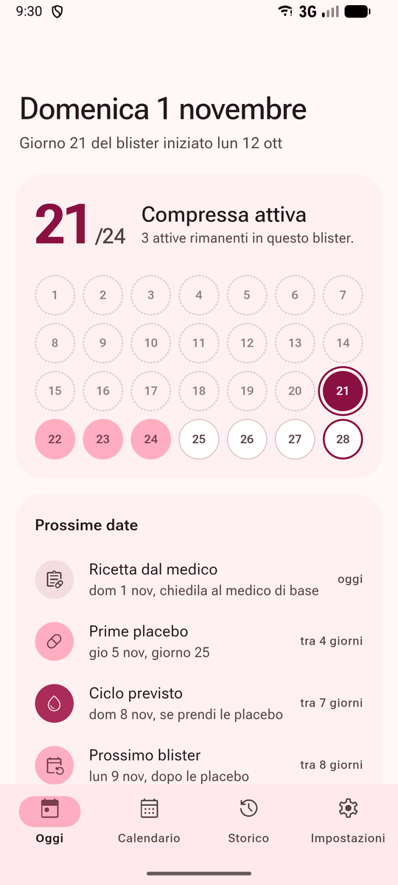
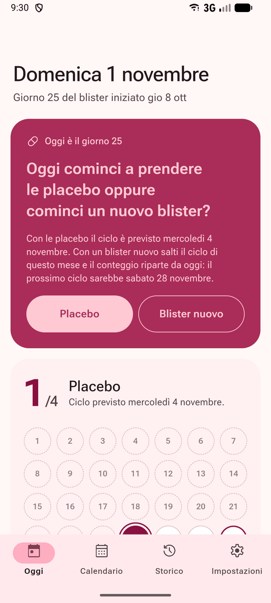
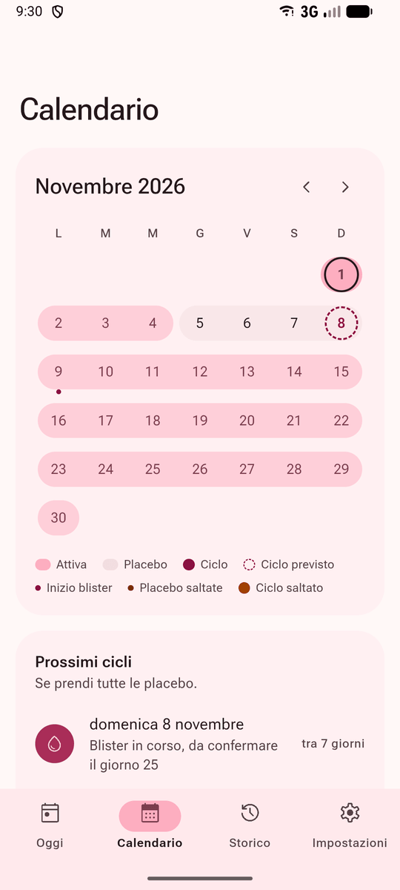
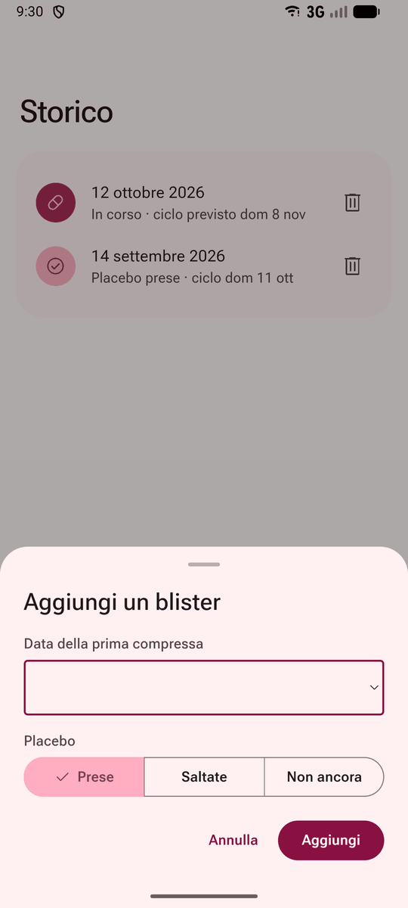
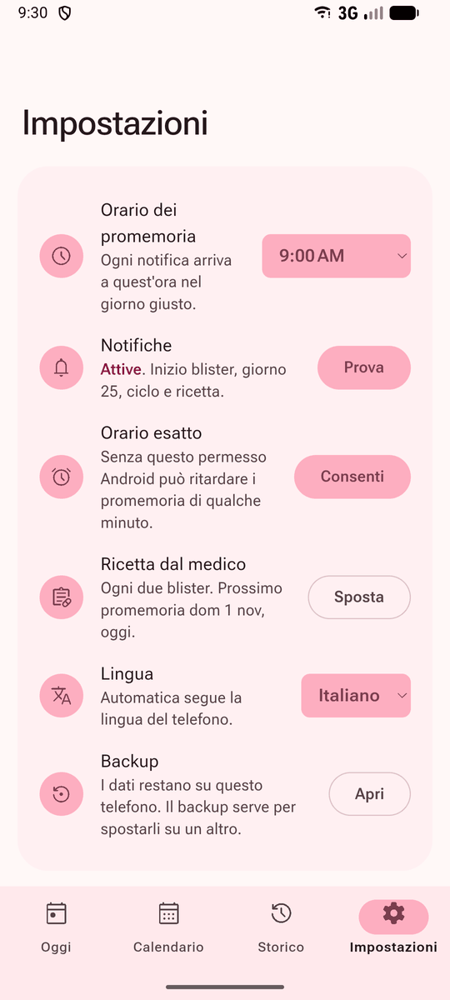
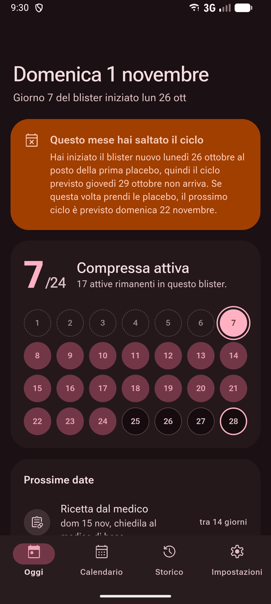

<p align="center">
  
</p>

<h1 align="center">Diario Yaz</h1>

<p align="center">
  Un diario Android per la pillola Yaz (24 compresse attive e 4 placebo).<br>
  Tiene il conto del blister, prevede il ciclo e manda promemoria a cui rispondi direttamente dalla notifica.
</p>

<p align="center">
  Leggi in: <a href="README.md">English</a> · Italiano
</p>

<p align="center">
  
  
  
  
  
</p>

## Da dove partire

| Vuoi | Vai a |
|---|---|
| **Installarla sul telefono** | [Installazione](#installazione): l'APK è nelle Releases di questo repository. |
| **Vederla prima** | [Com'è fatta](#comè-fatta): gli screenshot di ogni schermata. |
| **Sapere quando arrivano i promemoria** | [Promemoria](#promemoria): cosa chiede ogni notifica e quando. |
| **Modificare il codice** | [Sviluppo](#sviluppo): npm, test e un APK compilato sul tuo computer. |

[Come funziona](#come-funziona) · [Com'è fatta](#comè-fatta) · [Promemoria](#promemoria) · [Installazione](#installazione) ·
[Sviluppo](#sviluppo) · [Domande](#domande-frequenti)

## Come funziona

Inserisci il giorno in cui hai preso la prima compressa del blister attuale. Da lì l'app conta i giorni e ti chiede
solo quello che non può sapere da sola: se hai preso le placebo e quando hai cominciato il blister successivo.

| Giorno del blister | Cosa fa l'app |
|---|---|
| **Da 1 a 24** | Compresse attive. La schermata Oggi mostra a quale sei e quante ne restano. |
| **25** | Chiede se cominci le placebo o un nuovo blister. Con il blister nuovo il conteggio riparte da quel giorno e quel mese salti il ciclo. |
| **28** | Ciclo previsto, nel giorno della quarta placebo. |
| **29** | Chiede se hai cominciato un nuovo blister. Se rispondi No, te lo richiede il giorno dopo. |
| **21, ogni due blister** | Ricorda di chiedere la nuova ricetta al medico di base. |

Le previsioni per i blister successivi suppongono che tu prenda tutte le placebo, e ogni risposta ricalcola le date
che seguono.

## Com'è fatta

| | |
|---|---|
|  |  |
| *Oggi: la compressa a cui sei, il blister e le prossime date* | *Giorno 25: placebo o blister nuovo, con un tocco* |
|  |  |
| *Calendario: ogni blister è una fascia sul mese* | *Storico: aggiunta di un blister passato* |
|  |  |
| *Impostazioni: orario, ricetta, lingua, backup* | *Tema scuro, dopo un ciclo saltato* |

| Schermata | Cosa c'è |
|---|---|
| **Oggi** | La domanda del giorno quando c'è, il blister con le compresse già prese e le prossime date in ordine: placebo, ciclo, nuovo blister, ricetta. |
| **Calendario** | Giorni attivi, placebo, cicli previsti e saltati, mese per mese (scorri di lato o usa le frecce per cambiare mese); toccando un giorno vedi cos'è (numero della compressa, placebo, ciclo). Sotto, l'elenco dei prossimi cicli. |
| **Storico** | I blister registrati, con le placebo prese o saltate. Puoi aggiungere blister passati, modificarne data di inizio e placebo, o eliminarne uno. |
| **Impostazioni** | Orario dei promemoria, prova delle notifiche, orario esatto, promemoria della ricetta, lingua e backup. |

L'app segue la lingua del telefono (italiano, altrimenti inglese) e il suo tema chiaro o scuro. La lingua si può
anche scegliere nelle Impostazioni.

## Promemoria

| Notifica | Quando | Pulsanti |
|---|---|---|
| **Placebo o blister nuovo?** | Giorno 25, ripetuta i giorni 26 e 27 finché non rispondi | Placebo, Blister nuovo |
| **Nuovo blister** | Il giorno dopo l'ultima placebo, per quattro giorni | Sì, No |
| **Ciclo previsto oggi** | Giorno 28 | |
| **Questo mese salti il ciclo** | Il giorno in cui sarebbe arrivato il ciclo saltato | |
| **Ricetta dal medico** | Giorno 21, ogni due blister | |

Le notifiche sono locali, senza server e senza connessione. L'app programma i 100 giorni successivi nelle sveglie di
Android, che le mostrano anche ad app chiusa, e dopo un riavvio il plugin delle notifiche le riprogramma. A ogni
apertura dell'app l'elenco si allunga, quindi i promemoria finiscono solo se non la apri per più di tre mesi.

Su Android 14 e successivi i promemoria possono arrivare con qualche minuto di ritardo finché non premi **Consenti**
alla voce "Orario esatto" nelle Impostazioni dell'app.

## Installazione

| Dove | Cosa succede |
|---|---|
| **GitHub** | A ogni push su `main` parte [`build-apk.yml`](.github/workflows/build-apk.yml): test, APK di release e una nuova versione nelle [Releases](https://github.com/FrancescoPazz/diario-yaz/releases/latest) con il file `diario-yaz-N.apk`, dove N è il numero della build. Una build dura circa quattro minuti. |
| **Sul telefono** | Il repository è privato: per scaricare l'APK serve l'accesso a GitHub nel browser. Android chiede il permesso di installare app da quel browser, e Play Protect può segnalare l'app come sconosciuta perché non arriva dal Play Store. |
| **Aggiornamenti** | Ogni versione si installa sopra la precedente senza perdere i dati: la chiave di firma è sempre la stessa e il numero di versione cresce con la build. |

## Sviluppo

Servono Node.js 22, JDK 21 e l'SDK Android, che si installa con Android Studio. Capacitor 8 compila per Java 21: con
`JAVA_HOME` su Java 17 Gradle si ferma.

```bash
npm install      # una volta sola
npm test         # calcoli sulle date e traduzioni
npm run build    # crea www/; aprendo www/index.html vedi l'interfaccia nel browser, senza notifiche
npm run sync     # build e copia di www/ nel progetto Android
npm run open     # apre android/ in Android Studio
```

Dopo ogni modifica in `src/` lancia `npm run sync`, poi in Android Studio premi Run ▶ con il telefono collegato via
USB (debug USB attivo) o con un emulatore.

Senza Android Studio, l'APK di debug si compila con `npm run apk` su macOS e Linux. Su Windows npm esegue gli script
con `cmd`, che non riconosce `./gradlew`, quindi da PowerShell:

```powershell
$env:JAVA_HOME = "C:\percorso\del\jdk-21"
npm run sync
cd android; .\gradlew.bat assembleDebug
```

Il file finisce in `android/app/build/outputs/apk/debug/app-debug.apk`. Con il telefono collegato lo installi con
`adb install -r` seguito dal percorso (`adb` è nella cartella `platform-tools` dell'SDK); `-r` sostituisce la versione
installata e conserva i dati.

Una build locale ha numero di versione 1, e Android non la installa sopra una versione scaricata da GitHub, che ha un
numero più alto. Per provarla su un telefono che ha già l'app da GitHub bisogna disinstallare l'app, dopo aver fatto
un backup, oppure usare un emulatore.

<details>
<summary><b>Traduzioni</b></summary>

Tutti i testi stanno in [`src/i18n.js`](src/i18n.js), un blocco per lingua con le stesse chiavi, notifiche comprese.
`npm test` fallisce se a una delle due lingue manca una chiave, o se una notifica esce senza titolo o senza testo. La
lingua è quella scelta nelle Impostazioni; con Automatica è l'italiano se il telefono è in italiano e l'inglese in tutti
gli altri casi. Cambiando lingua anche le notifiche vengono riprogrammate con i nuovi testi.

</details>

<details>
<summary><b>Struttura del progetto</b></summary>

| Percorso | Contenuto |
|---|---|
| `src/logic.js` | Calcoli: giorno del blister, placebo, cicli previsti e saltati, ricetta, programma delle notifiche, risposte |
| `src/i18n.js` | Testi in italiano e inglese, formati delle date |
| `src/app.js` | Interfaccia, salvataggio sul telefono, notifiche e pulsanti |
| `src/index.html`, `src/styles.css` | Pagina e stile, con i token colore Material 3 in cima al CSS |
| `scripts/test-logic.mjs` | Test (`npm test`) |
| `scripts/build.mjs` | Crea la cartella `www/` che va nell'app |
| `assets/` | Icona e schermata di avvio (si rigenerano con `npm run icons`) |
| `docs/` | Logo e screenshot di questo README |
| `android/` | Progetto Android generato da Capacitor |
| `.github/workflows/build-apk.yml` | Build dell'APK su GitHub |

</details>

<details>
<summary><b>Firma</b></summary>

`android/app/build.gradle` firma le build di debug e di release con la chiave dell'app, che **non** è nel repository.
Su GitHub il workflow la legge da quattro secret del repository (Settings › Secrets and variables › Actions):

| Secret | Contenuto |
|---|---|
| `DIARIOYAZ_KEYSTORE_BASE64` | il file keystore codificato in base64 (`base64 -w0 diario-yaz.keystore`) |
| `DIARIOYAZ_STORE_PASSWORD` | la password del keystore |
| `DIARIOYAZ_KEY_ALIAS` | l'alias della chiave |
| `DIARIOYAZ_KEY_PASSWORD` | la password della chiave |

Per un APK firmato sul computer, crea `android/keystore.properties` (escluso da git) con `storeFile` (percorso relativo a `android/app`), `storePassword`,
`keyAlias` e `keyPassword`. Senza quel file le build locali usano la chiave di debug standard di Android. Se la chiave
cambia, Android rifiuta l'aggiornamento: l'app va disinstallata e i dati si perdono, a meno di averne fatto un backup.

</details>

L'app usa [Capacitor 8](https://capacitorjs.com) con i plugin ufficiali `@capacitor/preferences` per il salvataggio,
`@capacitor/local-notifications` per i promemoria con i pulsanti e `@capacitor/app` per aggiornare la pagina quando
l'app torna in primo piano. L'interfaccia segue Material 3: i colori sono uno schema generato da `#A92D58` con
`@material/material-color-utilities`, le icone sono Material Symbols e il font è Roboto Flex, incluso così l'app
funziona anche offline.

## Domande frequenti

<details>
<summary><b>L'app manda i miei dati da qualche parte?</b></summary>

No. I dati stanno nelle preferenze dell'app su Android e il codice non fa richieste di rete. Anche le notifiche sono
programmate sul telefono. I dati restano se chiudi l'app o riavvii il telefono e spariscono solo se la disinstalli.

</details>

<details>
<summary><b>Un promemoria è arrivato con qualche minuto di ritardo. Perché?</b></summary>

Da Android 14 il sistema può ritardare le sveglie delle app che non hanno il permesso "orario esatto". Apri le
Impostazioni dell'app e premi **Consenti** alla voce "Orario esatto".

</details>

<details>
<summary><b>Cambio telefono. Come tengo lo storico?</b></summary>

Nelle Impostazioni apri Backup e copia il testo. Sul nuovo telefono la prima schermata ha "Ho un backup da
ripristinare": incolla lì il testo.

</details>

<details>
<summary><b>Il promemoria della ricetta cade nel blister sbagliato.</b></summary>

L'app non sa quando hai preso l'ultima ricetta, quindi conta dal primo blister del diario. Nelle Impostazioni,
**Sposta** alla voce "Ricetta dal medico" lo porta al blister accanto, e tutti i promemoria successivi si adeguano.

</details>

<details>
<summary><b>Funziona con altre pillole?</b></summary>

Solo con lo schema 24 + 4 di Yaz. Con pillole da 21 compresse e 7 giorni di pausa, o con altri schemi, le date
risultano sbagliate.

</details>

Le previsioni non sostituiscono le indicazioni del medico o del foglietto illustrativo.
