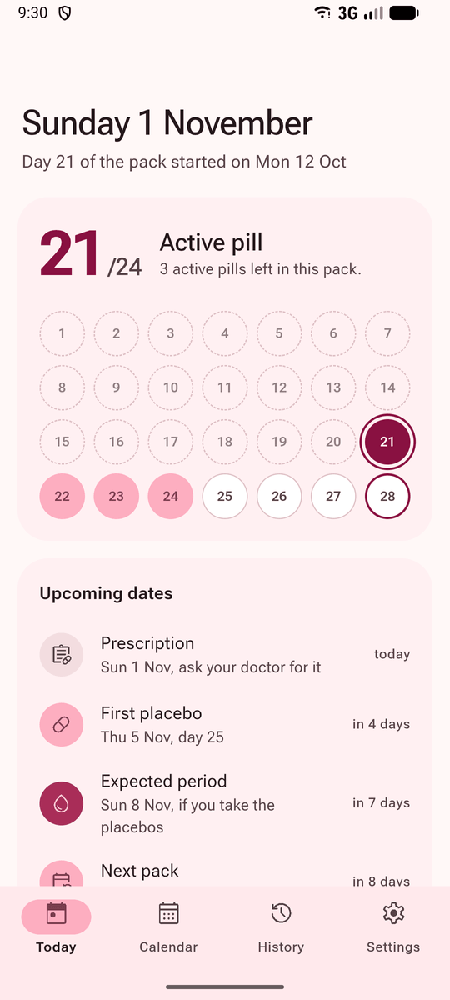
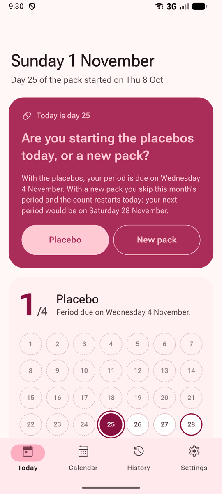
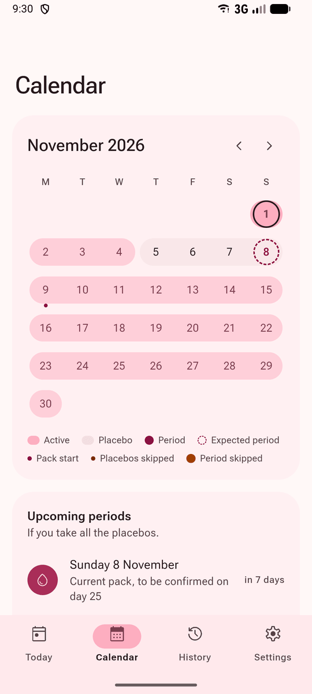
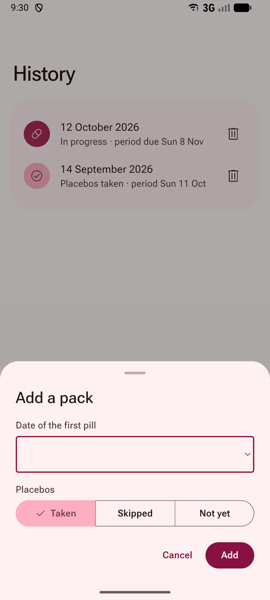
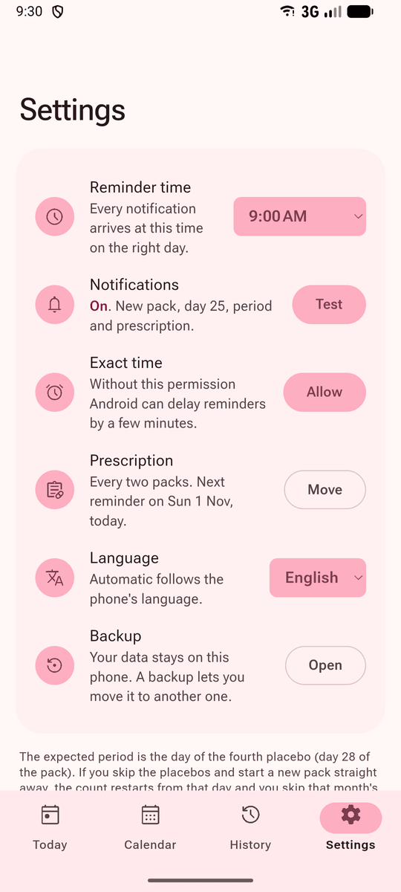
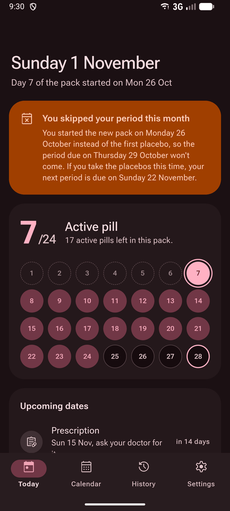

<p align="center">
  
</p>

<h1 align="center">Diario Yaz</h1>

<p align="center">
  An Android diary for the Yaz pill (24 active pills and 4 placebos).<br>
  It tracks the pack, forecasts your period and sends reminders you can answer from the notification.
</p>

<p align="center">
  Read in: English · <a href="README.it.md">Italiano</a>
</p>

<p align="center">
  
  
  
  
  
</p>

## Start here

| You want to | Go to |
|---|---|
| **Install it on your phone** | [Install](#install): the APK is in the Releases of this repository. |
| **See it first** | [What you get](#what-you-get): screenshots of every screen. |
| **Know when the reminders arrive** | [Reminders](#reminders): what each notification asks and when. |
| **Change the code** | [Development](#development): npm, tests and a local APK. |

[How it works](#how-it-works) · [What you get](#what-you-get) · [Reminders](#reminders) · [Install](#install) ·
[Development](#development) · [Questions](#questions-people-ask)

## How it works

You enter the day you took the first pill of the current pack. From then on the app counts the days and asks only
what it can't work out by itself: whether you took the placebos, and when you started the next pack.

| Day of the pack | What the app does |
|---|---|
| **1 to 24** | Active pills. The Today screen shows which one you are on and how many are left. |
| **25** | Asks whether you are starting the placebos or a new pack. With a new pack the count restarts that day and you skip that month's period. |
| **28** | Expected period, on the day of the fourth placebo. |
| **29** | Asks whether you started a new pack. Answer No and it asks again the next day. |
| **21, every two packs** | Reminds you to ask your doctor for a new prescription. |

Forecasts for the packs ahead assume you take all the placebos, and every answer recalculates the dates that follow.

## What you get

| | |
|---|---|
|  |  |
| *Today: the pill you are on, the pack and the upcoming dates* | *Day 25: placebos or a new pack, answered with one tap* |
|  |  |
| *Calendar: each pack as a band across the month* | *History: adding an older pack* |
|  |  |
| *Settings: reminder time, prescription, language, backup* | *Dark theme, after a skipped period* |

| Screen | What is on it |
|---|---|
| **Today** | The question of the day when there is one, the pack with the pills already taken, and the next dates in order: placebos, period, new pack, prescription. |
| **Calendar** | Active days, placebos, expected periods and skipped ones, month by month (swipe sideways or use the arrows to change month); tap a day to see what it is (pill number, placebo, period). Below it, the list of the next periods. |
| **History** | The packs you recorded and whether you took or skipped the placebos. You can add older packs, edit the start date or placebo outcome of one, or delete it. |
| **Settings** | Reminder time, notification test, exact time, prescription reminder, language and backup. |

The app follows the phone's language (Italian, otherwise English) and its light or dark theme. You can also pick the
language in Settings.

## Reminders

| Notification | When | Buttons |
|---|---|---|
| **Placebos or a new pack?** | Day 25, repeated on days 26 and 27 until you answer | Placebo, New pack |
| **New pack** | The day after the last placebo, for four days | Yes, No |
| **Period due today** | Day 28 | |
| **You skip your period this month** | The day the skipped period would have come | |
| **Prescription** | Day 21, every two packs | |

The notifications are local: no server and no connection. The app schedules the next 100 days in Android's alarms,
which show them even with the app closed, and the notification plugin schedules them again after a reboot. Every time
you open the app the list moves forward, so reminders stop only if you don't open it for more than three months.

On Android 14 and later, reminders can arrive a few minutes late until you press **Allow** next to "Exact time" in the
app's Settings.

## Install

| Where | What happens |
|---|---|
| **GitHub** | Every push to `main` runs [`build-apk.yml`](.github/workflows/build-apk.yml): tests, release APK, and a new entry in [Releases](https://github.com/FrancescoPazz/diario-yaz/releases/latest) with the file `diario-yaz-N.apk`, where N is the build number. A build takes about four minutes. |
| **On the phone** | The repository is private, so you need to be signed in to GitHub in the browser to download the APK. Android asks permission to install apps from that browser, and Play Protect may warn that the app is unknown because it doesn't come from the Play Store. |
| **Updates** | Each version installs over the previous one and keeps the data: the signing key never changes and the version number grows with the build. |

## Development

You need Node.js 22, JDK 21 and the Android SDK, which Android Studio installs. Capacitor 8 compiles for Java 21, so
Gradle stops if `JAVA_HOME` points to Java 17.

```bash
npm install      # once
npm test         # date calculations and translations
npm run build    # builds www/; open www/index.html to see the UI in a browser, without notifications
npm run sync     # build, then copy www/ into the Android project
npm run open     # opens android/ in Android Studio
```

After every change in `src/` run `npm run sync`, then press Run ▶ in Android Studio with the phone connected over
USB (USB debugging on) or with an emulator.

To build the debug APK without Android Studio, `npm run apk` works on macOS and Linux. On Windows npm runs scripts
with `cmd`, which doesn't understand `./gradlew`, so use PowerShell:

```powershell
$env:JAVA_HOME = "C:\path\to\jdk-21"
npm run sync
cd android; .\gradlew.bat assembleDebug
```

The file ends up in `android/app/build/outputs/apk/debug/app-debug.apk`. With the phone connected, install it with
`adb install -r` followed by that path (`adb` is in the SDK's `platform-tools` folder); `-r` replaces the installed
version and keeps the data.

A local build has version number 1, and Android won't install it over a version downloaded from GitHub, which has a
higher number. To try it on a phone that already has the GitHub version, uninstall the app after making a backup, or
use an emulator.

<details>
<summary><b>Translations</b></summary>

All the text is in [`src/i18n.js`](src/i18n.js), one block per language with the same keys, notifications included.
`npm test` fails if a key is missing from one of the two languages, or if a notification comes out without a title or
a body. The language is the one chosen in Settings; on Automatic it is Italian when the phone is in Italian and English
in every other case. Switching language also reschedules the notifications with the new text.

</details>

<details>
<summary><b>Project layout</b></summary>

| Path | Contents |
|---|---|
| `src/logic.js` | Calculations: day of the pack, placebos, expected and skipped periods, prescription, notification schedule, answers |
| `src/i18n.js` | Italian and English text, date formats |
| `src/app.js` | Interface, saving on the phone, notifications and buttons |
| `src/index.html`, `src/styles.css` | Page and style, with the Material 3 color tokens at the top of the CSS |
| `scripts/test-logic.mjs` | Tests (`npm test`) |
| `scripts/build.mjs` | Builds the `www/` folder that goes into the app |
| `assets/` | Icon and splash screen (regenerate with `npm run icons`) |
| `docs/` | Logo and screenshots for this README |
| `android/` | Android project generated by Capacitor |
| `.github/workflows/build-apk.yml` | APK build on GitHub |

</details>

<details>
<summary><b>Signing</b></summary>

`android/app/build.gradle` signs debug and release builds with the app's own key, which is **not** stored in the
repository. On GitHub, the workflow reads it from four repository secrets (Settings › Secrets and variables › Actions):

| Secret | Content |
|---|---|
| `DIARIOYAZ_KEYSTORE_BASE64` | the keystore file encoded in base64 (`base64 -w0 diario-yaz.keystore`) |
| `DIARIOYAZ_STORE_PASSWORD` | the keystore password |
| `DIARIOYAZ_KEY_ALIAS` | the key alias |
| `DIARIOYAZ_KEY_PASSWORD` | the key password |

To build a signed APK on your computer, create `android/keystore.properties` (ignored by git) with `storeFile` (path relative to `android/app`),
`storePassword`, `keyAlias` and `keyPassword`. Without it, local builds use Android's standard debug key. If the key
changes, Android refuses the update: the app has to be uninstalled and the data is lost unless you have a backup.

</details>

The app is built with [Capacitor 8](https://capacitorjs.com) and the official plugins `@capacitor/preferences` (saving),
`@capacitor/local-notifications` (reminders with buttons) and `@capacitor/app` (refreshing the page when the app comes
back to the foreground). The interface follows Material 3: the colors are a scheme generated from `#A92D58` with
`@material/material-color-utilities`, the icons are Material Symbols and the font is Roboto Flex, bundled so the app
works offline.

## Questions people ask

<details>
<summary><b>Does the app send my data anywhere?</b></summary>

No. The data lives in Android's app preferences and the code makes no network requests. Notifications are scheduled on
the phone. The data stays when you close the app or restart the phone and goes away only if you uninstall it.

</details>

<details>
<summary><b>A reminder arrived a few minutes late. Why?</b></summary>

Android 14 and later can delay the alarms of apps that don't have the "exact time" permission. Open the app's Settings and
press **Allow** next to "Exact time".

</details>

<details>
<summary><b>I'm moving to a new phone. How do I keep the history?</b></summary>

In Settings, open Backup and copy the text. On the new phone, the first screen has "I have a backup to restore": paste
the text there.

</details>

<details>
<summary><b>The prescription reminder falls in the wrong pack.</b></summary>

The app can't know when you got your last prescription, so it counts from the first pack in the diary. In Settings,
**Move** next to "Prescription" shifts it to the neighbouring pack, and every later reminder follows.

</details>

<details>
<summary><b>Does it work with other pills?</b></summary>

Only with the 24 + 4 regimen of Yaz. Pills with 21 active days and a 7-day break, or other schemes, give wrong dates.

</details>

The forecasts don't replace your doctor's advice or the package leaflet.
